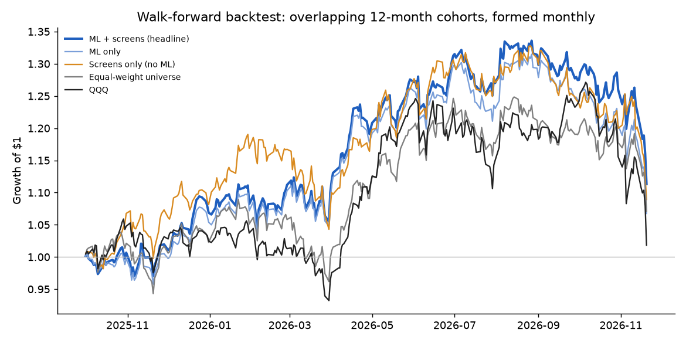

# nasdaq-equity-research

[](https://github.com/cwford06/nasdaq-equity-research/actions/workflows/tests.yml)

Quantitative equity research on Nasdaq stocks. The pipeline pulls fundamentals and prices from Yahoo
Finance and scores every stock on **revenue growth**, **margin expansion** and **valuation**. A
machine-learning model then picks stocks and puts a **12-month price target** (with bear and bull
cases) on each one. Every step is backtested walk-forward, so the model only ever sees data that was
public on the day it made its picks.

```
eqr run                      # full Nasdaq (Global Select + Global Market), top 20 picks
eqr run --universe nasdaq100 # faster: Nasdaq-100 only
```

A [scheduled workflow](.github/workflows/refresh-picks.yml) re-runs `eqr run --strict` every Saturday
and commits the refreshed reports, so `reports/` always holds the latest picks. Each week's picks are
also kept as a dated `picks_YYYY-MM-DD.md`. If Yahoo or Nasdaq return incomplete data, the run fails
and publishes nothing. You can also start it by hand from the Actions tab.

Outputs go to [`reports/`](reports):

| File | What it is |
|---|---|
| [`picks_latest.md`](reports/picks_latest.md) | Current picks, price targets and a short research note for each |
| [`backtest.md`](reports/backtest.md) | Walk-forward results, IC, price-target accuracy, signal study, caveats |
| `picks_latest.csv`, `universe_scores_latest.csv` | Machine-readable picks and scores for the whole eligible universe |
| `backtest_*.csv`, `factor_ic.csv` | Raw backtest output (cohorts, daily returns, every historical prediction) |

## Results (run of 2026-11-20)

Universe: about 650 eligible Nasdaq stocks a month (Global Select and Global Market, over $1B market cap,
Finance and Real Estate excluded). Walk-forward from Oct 2025 to Nov 2026, with 14 overlapping monthly
cohorts, of which 2 have a full 12-month outcome.

| Strategy | Total return | Sharpe (rf=0) | Max drawdown |
|---|---|---|---|
| **ML + screens (headline)** | **11.3%** | 0.58 | -16.7% |
| ML only | 6.7% | 0.39 | -18.8% |
| Screens only (no ML) | 8.9% | 0.47 | -18.0% |
| Equal-weight universe | 7.1% | 0.40 | -14.2% |
| QQQ | 1.8% | 0.18 | -19.9% |

**How to read this:**

- **The model's ranking didn't hold up.** The top-20 portfolio beat the equal-weight universe and QQQ,
  but the model's rank IC across the *whole* universe was negative on every formation date (mean −0.09).
  So the portfolio result rests on a handful of names and cannot be told apart from luck at this sample
  size. The rule-based screens had a mean IC of +0.05.
- **The price targets were no more accurate** than a flat +8% target (median absolute error 30.6% vs
  29.9%). The bear–bull ranges are roughly calibrated: 72% of outcomes fell inside a nominal 80% band.
- **Margin signals held up best.** Over all 19 fully labelled months, margin expansion and level signals
  (incremental operating margin, operating margin, gross-margin change) were the most consistently
  positive. Raw revenue growth was slightly negative over this period.
- **Version history:** the first model version used size and volatility features as well, and did worse
  (see *Model versions tried* in the report). The changes were made after seeing its results, which the
  report flags as a source of selection bias.

Full details: [reports/backtest.md](reports/backtest.md). Current picks: [reports/picks_latest.md](reports/picks_latest.md).



## How it works

```
Nasdaq listings (ex Finance & Real Estate, one ticker per company)
        │
        ▼
Yahoo Finance: 4 fiscal years of statements, 5 quarters, daily prices
        │
        ▼
point-in-time feature panel (one row per stock per month-end)
  • revenue growth:   YoY growth, acceleration, 2-year CAGR
  • margin expansion: gross / operating / net / FCF margin and their YoY change,
                      incremental operating margin
  • valuation:        sales/EV, EBIT/EV, earnings yield, FCF yield, book/market,
                      EV/Sales-to-growth
  • momentum:         12-1 month price momentum
        │
   ┌────┴─────────────────────────┐
   ▼                              ▼
pillar screens (rules)       ML ensemble (scikit-learn)
growth / margin / value      gradient-boosted trees + ridge on
percentile scores            cross-sectional ranks, predicting the
pass = top half              12m log return vs the median stock;
                             10th / 90th percentile models for bear / bull
   └────┬─────────────────────────┘
        ▼
picks: pass >= 2 of 3 screens, ranked by the ML forecast, top 20, at most 5 per sector
target = price x (1 + 8% assumed market return) x exp(predicted excess)
```

Size, volatility and short-term price features are computed too. They appear in the signal study,
and the backtest re-runs the first model version that used them, but the live model leaves them out.

### The three research methods

All three live in [`features.py`](src/eqresearch/features.py) and are scored in
[`screens.py`](src/eqresearch/screens.py):

- **`revenue_growth_features`**: last fiscal year's revenue growth, whether it is accelerating or
  slowing, and the 2-year CAGR. The research notes also show the latest quarter's year-over-year growth.
- **`margin_expansion_features`**: margin levels and their year-over-year change in percentage points,
  plus *incremental operating margin* (how much of each new revenue dollar reached operating profit),
  which is a direct measure of operating leverage.
- **`valuation_features`**: yields rather than multiples (sales/EV, EBIT/EV, earnings yield, FCF
  yield), because yields stay meaningful when earnings are negative. Also EV/Sales divided by growth,
  a PEG-style ratio for revenue.

Each pillar score is the average cross-sectional percentile rank of its metrics on that date. A
stock passes a pillar when it scores in the top half.

### Avoiding look-ahead

- A fiscal year's numbers only enter the panel **90 days after the year ends**, which is after the
  10-K filing deadline for every filer category.
- Valuation uses the price on the as-of date and the share count from the latest *available* balance
  sheet. Yahoo's share counts and prices are both split-adjusted, so the two are consistent.
- On each backtest date the model is retrained using only samples whose 12-month outcome had
  **fully played out** by that date. A unit test asserts this for every fit.
- A leakage check on pure-noise synthetic data gives a mean IC of about zero (−0.05 to +0.10 across
  seeds), which is also the noise band to keep in mind when reading the real ICs.

## Install

```bash
git clone https://github.com/cwford06/nasdaq-equity-research.git
cd nasdaq-equity-research
python -m venv .venv && source .venv/bin/activate
pip install -e ".[dev]"
eqr run
pytest
```

The first full-Nasdaq run downloads statements for about 1,900 tickers, which takes roughly 5-10
minutes depending on Yahoo's rate limiting. Everything is cached in `data/cache/` (statements for 7
days, prices for 12 hours), so later runs take about a minute. yfinance returns *empty* tables rather
than errors when rate limited, so the downloader checks a known-good ticker before trusting an empty
answer and retries the rest in slower rounds.

Useful options: `--top 30`, `--min-mcap 5` (in $bn), `--min-screens 3` (must pass all three screens),
`--market-return 0.06`, `--max-per-sector 0` (no sector cap), `--include-financials`,
`--max-tickers 300` (quick test).

The universe and sector labels come from Nasdaq's own listing APIs, because Yahoo doesn't publish index
membership. Banks, insurers, BDCs and REITs are excluded, because revenue growth, gross margin, EV/Sales
and FCF do not describe their economics. Duplicate share classes (GOOG/GOOGL, FOX/FOXA and so on) are
collapsed to one ticker.

## Limitations

- **Short point-in-time history.** Yahoo's free data covers only four fiscal years, so the honest
  backtest starts in 2024 and only a handful of cohorts have a full 12-month outcome. The backtest
  is a sanity check, not proof of an edge.
- **Survivorship bias.** The universe is today's listings. Stocks that delisted since 2024 are
  missing, which flatters every strategy, including the benchmarks.
- **Restatements.** Yahoo serves restated figures, not as-first-reported ones.
- **One regime.** 2024-2026 was dominated by a narrow AI and semiconductor rally.
- **The market-return assumption sets the level of every target.** The model forecasts *relative*
  performance. The absolute target adds an assumed 8% for the median stock (`--market-return`).
- No transaction costs, taxes or capacity constraints.

This is a research project, not investment advice.

## Layout

```
src/eqresearch/
  universe.py      Nasdaq-100 / Nasdaq listings and sectors (from Nasdaq's APIs)
  data.py          Yahoo Finance downloads, cache, rate-limit handling
  fundamentals.py  statements -> tidy annual panel; latest-quarter trends
  features.py      point-in-time panel: growth, margin, valuation, price features
  screens.py       pillar scores and screens
  model.py         ML ensemble, quantile models, price targets
  backtest.py      walk-forward fits, overlapping cohorts, IC, target accuracy
  report.py        markdown and charts
  pipeline.py      end-to-end run
  cli.py           `eqr` command
tests/             offline tests on synthetic data (no network)
```
