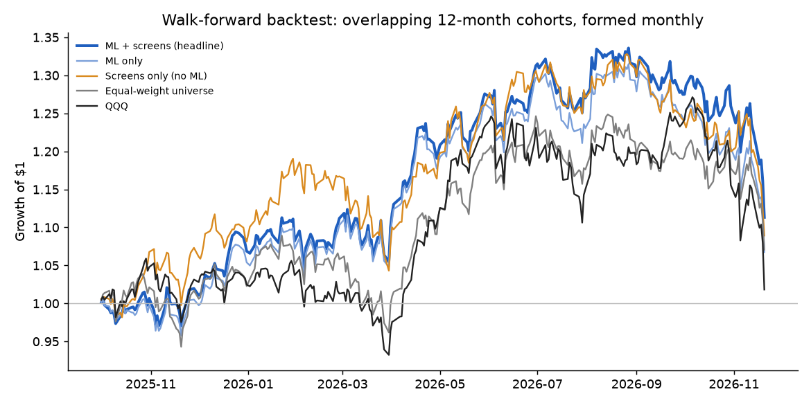
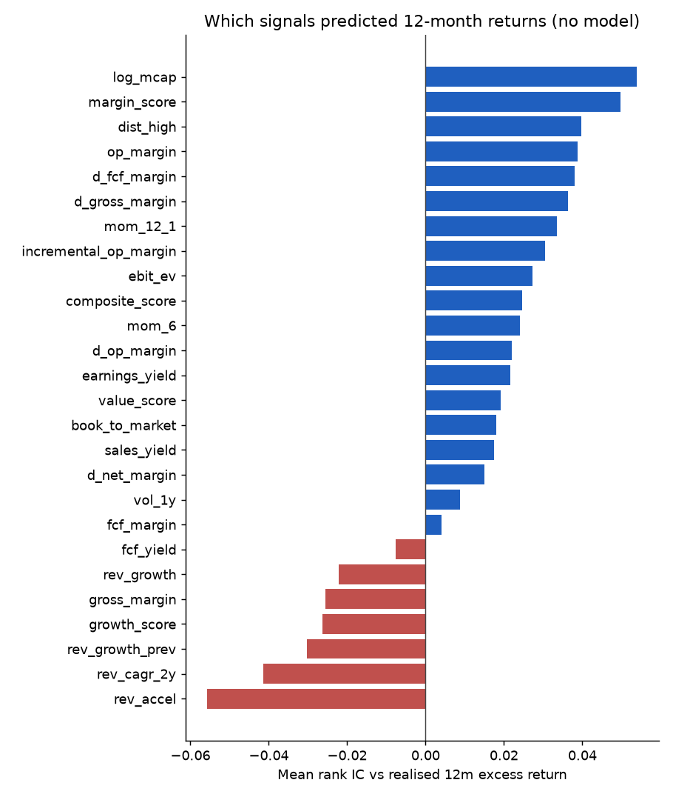

# Backtest report

Generated from Yahoo Finance data through **2026-11-20**. Universe: `nasdaq` (1465 tickers requested; 657 eligible in a typical month after the $1B market-cap, $5 price and data-availability filters). Finance and Real Estate stocks are excluded because revenue, margin and EV-based metrics do not describe lenders or REITs.

## Key findings

- **Headline strategy:** 11.3% vs 7.1% for the equal-weight universe and 1.8% for QQQ, from 2025-10-01 to 2026-11-20 (14 monthly cohorts, 2 with a full 12-month outcome).
- **Ranking skill:** the ML forecast's rank IC across the whole eligible universe averaged -0.086 and was positive on 0% of formation dates. So the top-20 outperformance did **not** come from the model ranking the universe well. It rests on a handful of names that passed the screens, and at this sample size it cannot be told apart from luck.
- **Rule-based screens alone:** mean rank IC +0.052.
- **Price targets:** median absolute error 30.6% vs 29.9% for a flat +8% target, so the model's targets were no more accurate than the naive baseline. 72% of realised prices landed inside the bear-bull range (nominally 80%).

## Setup

- **Formation dates:** 14 month-ends from 2025-09-30 to 2026-10-30. On each one the model is refit using only samples whose 12-month outcome was fully known by that date (minimum 6 monthly cross-sections).
- **Portfolios:** top 20 names, equal weight, held 12 months. Monthly cohorts overlap, and the strategy return is the average of all live cohorts.
- **Headline strategy (ML + screens):** stocks passing at least 2 of the 3 pillar screens (revenue growth, margin expansion, valuation), ranked by the ML forecast.
- **Price target:** price x (1 + 8% assumed median-stock return) x exp(predicted log excess return). Bear and bull cases come from 10th and 90th percentile models.
- **Costs:** none are modelled. A 12-month holding period keeps turnover low, but subtract roughly 0.1-0.3% a year for large caps.

## Strategy performance

| strategy | start | end | total_return | cagr | ann_vol | sharpe_rf0 | max_drawdown |
|---|---|---|---|---|---|---|---|
| ML + screens (headline) | 2025-10-01 | 2026-11-20 | 11.3% | 9.8% | 19.6% | 0.58 | -16.7% |
| ML only | 2025-10-01 | 2026-11-20 | 6.7% | 5.9% | 19.4% | 0.39 | -18.8% |
| Screens only (no ML) | 2025-10-01 | 2026-11-20 | 8.9% | 7.8% | 20.1% | 0.47 | -18.0% |
| Equal-weight universe | 2025-10-01 | 2026-11-20 | 7.1% | 6.2% | 19.8% | 0.40 | -14.2% |
| QQQ | 2025-10-01 | 2026-11-20 | 1.8% | 1.6% | 22.0% | 0.18 | -19.9% |

Cohorts formed after 2025-10-31 have not finished their 12 months yet. Their returns run to the latest close, so the last part of the curve uses partial holding periods.

### Per-cohort returns (formation date to 12 months later, or to date)

| date | matured | end | n_universe | n_candidates | ML + screens (headline) | ML only | Screens only (no ML) | Equal-weight universe | QQQ |
|---|---|---|---|---|---|---|---|---|---|
| 2025-09-30 | True | 2026-09-30 | 638 | 316 | 40.8% | 42.3% | 46.7% | 21.9% | 23.8% |
| 2025-10-31 | True | 2026-11-02 | 646 | 321 | 30.2% | 30.0% | 7.3% | 13.3% | 8.8% |
| 2025-11-28 | False | 2026-11-20 | 645 | 326 | 13.0% | 13.1% | 4.5% | 3.2% | -1.3% |
| 2025-12-31 | False | 2026-11-20 | 648 | 326 | 10.7% | 7.3% | -5.4% | 2.1% | -0.6% |
| 2026-01-30 | False | 2026-11-20 | 651 | 328 | 4.0% | 4.0% | -8.6% | -0.1% | -1.8% |
| 2026-02-27 | False | 2026-11-20 | 649 | 326 | 2.2% | 1.4% | -9.5% | -0.2% | 0.5% |
| 2026-03-31 | False | 2026-11-20 | 647 | 324 | -12.6% | -10.7% | -12.2% | 3.8% | 5.6% |
| 2026-04-30 | False | 2026-11-20 | 677 | 341 | -10.4% | -13.6% | -13.2% | -3.3% | -8.7% |
| 2026-05-29 | False | 2026-11-20 | 685 | 343 | -16.7% | -20.7% | -12.9% | -8.7% | -17.4% |
| 2026-06-30 | False | 2026-11-20 | 696 | 354 | -24.2% | -31.2% | -8.0% | -10.8% | -17.3% |
| 2026-07-31 | False | 2026-11-20 | 684 | 342 | -17.0% | -19.8% | -13.0% | -9.0% | -11.5% |
| 2026-08-31 | False | 2026-11-20 | 682 | 343 | -14.2% | -21.3% | -17.7% | -11.6% | -15.0% |
| 2026-09-30 | False | 2026-11-20 | 676 | 330 | -6.7% | -11.6% | -15.2% | -8.2% | -17.8% |
| 2026-10-30 | False | 2026-11-20 | 664 | 330 | -11.2% | -11.1% | -8.4% | -8.6% | -11.9% |

## Does the model rank stocks correctly?

Rank information coefficient (IC) is the Spearman correlation between the forecast and the realised return across stocks on a formation date. +1 is a perfect ranking and 0 is no skill. Monthly cross-sectional ICs of 0.03-0.08 are considered useful in practice. For calibration: on pure-noise synthetic data with the same structure, this backtest produces mean ICs between about -0.05 and +0.10, so values in that range cannot be told apart from luck.

- Matured cohorts (full 12 months, n=2): mean ML IC **-0.075**, mean screens-only IC -0.029
- Immature cohorts (returns to date, n=12): mean ML IC -0.088, mean screens-only IC 0.065

| date | matured | ml_ic | composite_ic |
|---|---|---|---|
| 2025-09-30 | True | -0.069 | -0.034 |
| 2025-10-31 | True | -0.082 | -0.024 |
| 2025-11-28 | False | -0.080 | -0.013 |
| 2025-12-31 | False | -0.029 | 0.012 |
| 2026-01-30 | False | -0.026 | 0.058 |
| 2026-02-27 | False | -0.015 | 0.134 |
| 2026-03-31 | False | -0.102 | 0.105 |
| 2026-04-30 | False | -0.148 | 0.139 |
| 2026-05-29 | False | -0.176 | 0.174 |
| 2026-06-30 | False | -0.194 | 0.150 |
| 2026-07-31 | False | -0.164 | 0.065 |
| 2026-08-31 | False | -0.079 | 0.002 |
| 2026-09-30 | False | -0.026 | 0.022 |
| 2026-10-30 | False | -0.016 | -0.064 |

ML forecast quintiles on matured cohorts (Q5 = highest forecast), as average 12m return minus the equal-weight universe:

| quintile | mean_return_vs_universe | pct_dates_beating_universe |
|---|---|---|
| Q1 | 11.9% | 100.0% |
| Q2 | -5.5% | 0.0% |
| Q3 | -3.6% | 0.0% |
| Q4 | -2.8% | 0.0% |
| Q5 | -0.1% | 50.0% |
| Q5-Q1 | -12.0% | 0.0% |

## Price-target accuracy (matured cohorts)

Compares each 12-month target with the price actually reached. The naive baseline gives every stock the same +8% target.

| metric | all eligible stocks | ml_screened picks |
|---|---|---|
| Targets evaluated | 1284 | 40 |
| Realised price inside bear-bull range | 71.7% | 75.0% |
| Direction correct (up vs down) | 54.4% | 72.5% |
| Realised price at or above target | 49.8% | 62.5% |
| Median abs. error, model (return pts) | 30.6% | 34.2% |
| Median abs. error, naive flat target | 29.9% | 33.5% |
| Mean implied return | 5.7% | 10.4% |
| Mean realised return | 17.5% | 35.5% |

## Model versions tried

Every model version is backtested on every run, so the version kept for live picks can be compared with the ones dropped. v1 also used size, volatility and short-term price features. During development, on a partial download (about 1,160 tickers, before rate-limited requests were retried), v1 leaned mainly on size and volatility and picked a cluster of small, volatile semiconductor stocks. On this run's data its most important features are gross_margin, rev_growth_prev, rev_cagr_2y, log_mcap, growth_score. v2 and v3 drop those features so the model stays about company fundamentals (revenue growth, margins, valuation) plus 12-1 month momentum, and v3 adds stronger regularisation because the training sample is small. These changes were made *after* seeing v1's backtest, so v3's numbers carry some selection bias. The fair reading is the whole table, not just the best row.

| model | matured_ml_ic | immature_ml_ic | ml_screened_total | ml_only_total | screens_only_total | universe_ew_total |
|---|---|---|---|---|---|---|
| v1: all features, standard trees | -0.066 | -0.153 | -2.9% | 0.7% | 8.9% | 7.1% |
| v2: fundamentals + momentum, standard trees | -0.088 | -0.122 | 4.2% | 0.3% | 8.9% | 7.1% |
| v3 (live): fundamentals + momentum, strong regularisation | -0.075 | -0.088 | 11.3% | 6.7% | 8.9% | 7.1% |

## Which research signals worked? (whole labelled sample, no model)

Mean monthly rank IC of each raw signal against realised 12-month excess return, across every as-of date with a complete 12-month outcome (19 dates). Overlapping 12-month windows mean neighbouring months are not independent, so treat this as descriptive.

| signal | mean_ic | ic_std | ic_ir | pct_dates_positive | n_dates |
|---|---|---|---|---|---|
| log_mcap | 0.054 | 0.127 | 0.426 | 52.6% | 19 |
| margin_score | 0.050 | 0.102 | 0.489 | 47.4% | 19 |
| dist_high | 0.040 | 0.109 | 0.365 | 68.4% | 19 |
| op_margin | 0.039 | 0.053 | 0.727 | 78.9% | 19 |
| d_fcf_margin | 0.038 | 0.082 | 0.463 | 52.6% | 19 |
| d_gross_margin | 0.036 | 0.054 | 0.672 | 68.4% | 19 |
| mom_12_1 | 0.033 | 0.091 | 0.366 | 63.2% | 19 |
| incremental_op_margin | 0.030 | 0.023 | 1.341 | 89.5% | 19 |
| ebit_ev | 0.027 | 0.051 | 0.534 | 68.4% | 19 |
| composite_score | 0.025 | 0.109 | 0.227 | 47.4% | 19 |
| mom_6 | 0.024 | 0.075 | 0.321 | 57.9% | 19 |
| d_op_margin | 0.022 | 0.128 | 0.173 | 47.4% | 19 |
| earnings_yield | 0.022 | 0.039 | 0.550 | 73.7% | 19 |
| value_score | 0.019 | 0.052 | 0.364 | 52.6% | 19 |
| book_to_market | 0.018 | 0.127 | 0.143 | 52.6% | 19 |
| sales_yield | 0.017 | 0.085 | 0.205 | 52.6% | 19 |
| d_net_margin | 0.015 | 0.115 | 0.132 | 52.6% | 19 |
| vol_1y | 0.009 | 0.104 | 0.084 | 63.2% | 19 |
| fcf_margin | 0.004 | 0.099 | 0.040 | 52.6% | 19 |
| fcf_yield | -0.008 | 0.045 | -0.171 | 47.4% | 19 |
| rev_growth | -0.022 | 0.128 | -0.174 | 47.4% | 19 |
| gross_margin | -0.026 | 0.112 | -0.228 | 47.4% | 19 |
| growth_score | -0.026 | 0.130 | -0.202 | 47.4% | 19 |
| rev_growth_prev | -0.030 | 0.285 | -0.106 | 18.2% | 11 |
| rev_cagr_2y | -0.041 | 0.294 | -0.141 | 27.3% | 11 |
| rev_accel | -0.056 | 0.199 | -0.280 | 72.7% | 11 |

Composite (screens-only) score quintiles over the same sample:

| quintile | mean_return_vs_universe | pct_dates_beating_universe |
|---|---|---|
| Q1 | 13.4% | 73.7% |
| Q2 | -2.5% | 36.8% |
| Q3 | -9.2% | 10.5% |
| Q4 | -5.5% | 26.3% |
| Q5 | 3.7% | 73.7% |
| Q5-Q1 | -9.7% | 36.8% |

## What the final model leans on

Permutation importance (drop in in-sample R^2 when a feature is shuffled) for the model used for the live picks:

| feature | importance |
|---|---|
| rev_cagr_2y | 0.0091 |
| rev_growth_prev | 0.0046 |
| ebit_ev | 0.0019 |
| growth_score | 0.0016 |
| gross_margin | 0.0016 |
| rev_accel | 0.0014 |
| margin_score | 0.0012 |
| fcf_margin | 0.0011 |
| rev_growth | 0.0008 |
| d_net_margin | 0.0007 |
| op_margin | 0.0006 |
| composite_score | 0.0005 |

## Caveats

- **Short history.** Yahoo serves only the last four fiscal years of statements, so the point-in-time backtest starts in 2024 and only a few cohorts have a full 12-month outcome. Read the results as a sanity check, not proof of an edge.
- **Survivorship bias.** The universe is today's Nasdaq listings, so companies that delisted or went bankrupt since 2024 are missing. This flatters every strategy, including the equal-weight benchmark.
- **Restated fundamentals.** Yahoo shows the latest restated figures, not what was first reported. The 90-day reporting lag guards against look-ahead on timing, but not on revisions.
- **One market regime.** 2024-2026 was dominated by a narrow group of AI and semiconductor winners. Signals that worked or failed here may behave differently in another regime.
